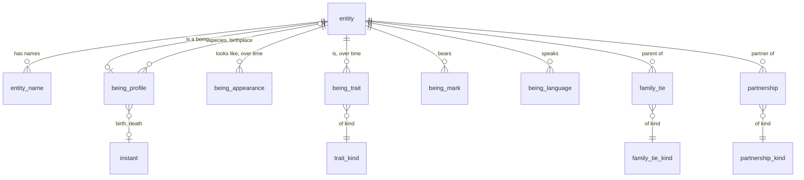
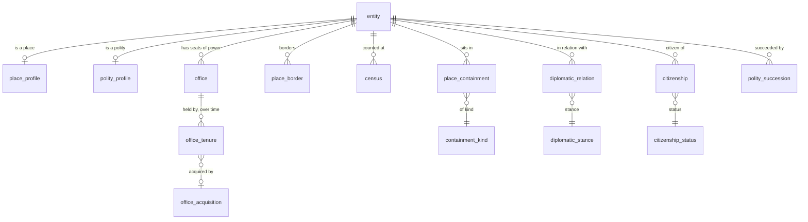
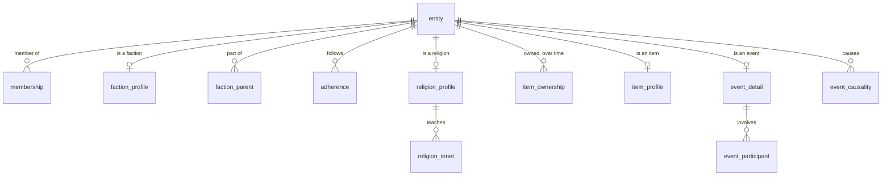
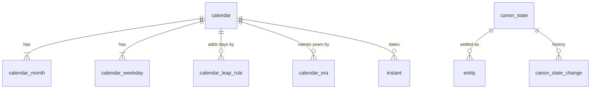

# Relational model

Status: **implemented.** The schema is
[`0001_initial_schema.sql`](../../src-tauri/crates/ontara-storage/migrations/0001_initial_schema.sql)
(79 tables). It was approved before it was built and is exercised end to end by the storage
tests: a universe that touches every table must come back identical after close, move and
reopen.

## Why this model

The first model kept worldbuilding knowledge in two generic tables and JSON columns. The domain
was in the data, not in the schema: "hair color" was a row, there was no table for a reign, a
membership or a census.

This model puts the domain in the schema:

- What every author needs has a table or a column with a name.
- What changes over time is a table with a period, never an overwritten value.
- What is particular to one universe goes to configurable properties, which stay.
- The application stays simple: read and write by table, and one rule engine on top.

## Conventions

| Rule | Meaning |
|---|---|
| Strict tables | Every table is `STRICT`; booleans are `0/1` with a `CHECK`. |
| Two clocks | `created_at` and `updated_at` are real time. In-universe time is an `instant` row. |
| Facts have periods | `time_state` is `unknown`, `unconstrained` or `known`; `starts_at` and `ends_at` point at instants and exist only when known. |
| Canon on every claim | `canon_state`, `origin`, `created_at`, `updated_at` on everything an author states. |
| Vocabularies are tables | Terms an author may extend (trait kinds, containment kinds, family ties) are catalog tables, so every use is a foreign key. |
| Unordered pairs are ordered | `first_id < second_id` on symmetric facts (borders, partnerships, diplomatic relations), so a pair is stored once. |

## Areas

| # | Area | Tables |
|---|---|---|
| 1 | Universe | `universe_profile` |
| 2 | Time | `calendar`, `calendar_month`, `calendar_weekday`, `calendar_leap_rule`, `calendar_era`, `instant` |
| 3 | Catalogs | `canon_state`, `entity_type`, `relationship_type`, `relationship_type_endpoint`, `appearance_kind`, `editorial_level`, `trait_kind`, `containment_kind`, `family_tie_kind`, `partnership_kind`, `diplomatic_stance`, `office_acquisition`, `item_acquisition`, `citizenship_status` |
| 4 | Entities | `entity`, `entity_name`, `tag`, `entity_tag`, `note` |
| 5 | Beings | `being_profile`, `being_appearance`, `being_mark`, `being_trait`, `being_language`, `family_tie`, `partnership`, `deity_profile`, `deity_domain`, `species_profile`, `species_habitat` |
| 6 | Places and polities | `place_profile`, `place_containment`, `place_border`, `place_resource`, `census`, `polity_profile`, `polity_language`, `polity_symbol`, `polity_succession`, `office`, `office_tenure`, `citizenship`, `diplomatic_relation` |
| 7 | Organizations | `faction_profile`, `faction_parent`, `membership` |
| 8 | Culture and belief | `culture_practice`, `culture_language`, `language_profile`, `religion_profile`, `religion_tenet`, `religion_deity`, `holy_place`, `adherence` |
| 9 | Items | `item_profile`, `item_power`, `item_ownership` |
| 10 | Events | `event_detail`, `event_participant`, `event_causality` |
| 11 | Narrative | `appearance`, `editorial_node` |
| 12 | Generic | `relationship`, `property_group`, `property_definition`, `property_choice_option`, `property_value` |
| 13 | Support | `asset_file`, `attachment`, `source`, `source_reference`, `canon_state_change` |

## Entity-relationship diagrams

### Entities and beings

### Places, polities and rule

### Organizations, belief, items and events

### Time and canon

## What the model answers in SQL

Each of these ran against a sample universe (see the validation notes below).

| Question | Built from |
|---|---|
| Everything inside the Northern Realm, at any depth | `place_containment` with a recursive query |
| Which realm was Ashmere in during year 90 | `place_containment` + `instant` |
| Who ruled the Northern Realm in year 120, and how they came to power | `office` + `office_tenure` + `office_acquisition` |
| How the population of a city changed | `census` |
| What hair color a character had in a given year | `being_appearance` |
| A character's fears, quirks and secrets | `being_trait` + `trait_kind` |
| Everything that led to an event | `event_causality` with a recursive query |
| A character's ancestors | `family_tie` with a recursive query |
| Members of a faction in a given year | `membership` |
| Who owns an item and how they got it | `item_ownership` + `item_acquisition` |

## What the schema itself rejects

A place inside itself; an unknown vocabulary term; a dated fact with no date; a negative
population; an unordered pair stored backwards; a fact about an entity that does not exist; a
property value with two values in one cell.

## What the domain engine enforces

SQL cannot express rules that depend on the entity type hierarchy or on following a chain, so
the engine in `ontara-core` keeps enforcing:

- A foreign key to `entity` points at the right kind of entity (a `birthplace_id` is a place, a
  `capital_id` is a settlement), honoring subtypes.
- Hierarchical facts never loop: `place_containment` per kind, `family_tie`,
  `faction_parent`, `polity_succession`, `event_causality`.
- A single-valued property may hold several values only when each has a period.
- Removing an entity requires an explicit decision for what depends on it.
- Citations and canon history point at an existing record, which the integrity check verifies.

## Built-in vocabulary

| Vocabulary | Terms |
|---|---|
| `trait_kind` | personality, value, goal, fear, quirk, habit, flaw, secret, ability, skill, weakness |
| `containment_kind` | geographic, political, administrative, religious |
| `family_tie_kind` | biological, adoptive, foster, step, guardian, spiritual |
| `partnership_kind` | marriage, betrothal, partnership, sworn bond |
| `diplomatic_stance` | alliance, war, truce, vassalage, protectorate, trade, rivalry, neutral |
| `office_acquisition` | inheritance, election, appointment, conquest, usurpation, acclamation, rotation |
| `item_acquisition` | crafted, inherited, gift, purchase, theft, found, conquest |
| `citizenship_status` | citizen, subject, resident, exile, hostage |

## Relation to the current schema

| Current | Becomes |
|---|---|
| `entity_alias` | `entity_name`, with kind, language, preferred flag and period |
| `property_value` for traits | `being_appearance`, `being_trait`, `being_mark`, `being_profile` |
| `relationship` `located_within` | `place_containment` |
| `relationship` `parent_of`, `spouse_of` | `family_tie`, `partnership` |
| `relationship` `affiliated_with` | `membership` |
| `relationship` `rules_over`, `capital_of`, `vassal_of`, `successor_of`, `allied_with`, `at_war_with` | `office`/`office_tenure`, `polity_profile`, `diplomatic_relation`, `polity_succession` |
| `relationship` `owns` | `item_ownership` |
| `relationship` `born_in`, `resides_in` | `being_profile.birthplace_id`, `place_containment`/`property_value` |
| `calendar.definition` (JSON) | `calendar_month`, `calendar_weekday`, `calendar_leap_rule`, `calendar_era` |
| `temporal` (JSON) | `time_state`, `starts_at`, `ends_at` over `instant` |
| `property_definition.data_type` (JSON) | typed column plus `property_choice_option` |
| `property_value.content` (JSON) | typed `value_*` columns |

`relationship` stays for what has no table of its own, and `property_definition` /
`property_value` stay for what is particular to one universe.

## Decisions

Approved. Where the review changed a decision, the change is noted.

1. **Class-table profiles.** A being's gender, birthplace and species are columns of
   `being_profile`, not properties. Any entity of a subtype of `being` may have a row.
2. **Appearance as periods.** Looks live in `being_appearance` with a period, so aging and
   disguises are rows, not edits.
3. **Offices apart from polities.** A reign is a tenure of an office, so a council, a
   regency or a co-rule is the same shape as a single king.
4. **No `is_current` flags.** Whether something holds today is derived from its period.
5. **Instants as rows, and a moment is what the author tells.** A moment always says
   something (a label, a day, or both); an exact position on the shared timeline is optional.
   A moment without a day cannot be ordered but exists, can be cited, and can be dated later.
6. **Fixed enumerations versus vocabularies.** Terms an author is likely to extend are
   vocabulary tables; closed sets with a fixed meaning (border kinds, proficiency levels) are
   `CHECK` lists.

## Verification

`tests/rules.rs` exercises the domain rules through a real project, and
`tests/worldbuilding_model.rs` loads a universe that touches every table, closes it, moves the
folder, reopens it and compares every table.
